<!-- Cabeçalho Original -->

  

  

 

<!-- Calendário de Contribuições Animado (Atualizado diariamente via GitHub Actions) -->
<h3><code>alveslim@github ~ $ ./contributions.sh</code></h3>

 
 

<!-- Retrato ASCII (Esquerda) + Card de Estatísticas (Direita) -->
<h3><code>alveslim@github ~ $ whoami</code></h3>

<table>
<tr>
<td valign="top"></td>
<td valign="top"></td>
</tr>
</table>

 

<b>💻 Estudante de Engenharia de Software · 🚀 IA & Sistemas · 🤖 Automação & Dados</b>

> *"Mar calmo nunca fez bom marinheiro."*

 

<!-- Snake Animation Original -->
<picture>
  <source media="(prefers-color-scheme: dark)" srcset="https://raw.githubusercontent.com/alveslim/alveslim/output/github-contribution-grid-snake-dark.svg">
  <source media="(prefers-color-scheme: light)" srcset="https://raw.githubusercontent.com/alveslim/alveslim/output/github-contribution-grid-snake.svg">
  
</picture>

 
 

<h3><code>alveslim@github ~ $ ./tech-stack.sh</code></h3>

  

 

<h3><code>alveslim@github ~ $ ./libs-and-frameworks.sh</code></h3>

   &nbsp;&nbsp;&nbsp;&nbsp;
   &nbsp;&nbsp;&nbsp;&nbsp;
   &nbsp;&nbsp;&nbsp;&nbsp;
   &nbsp;&nbsp;&nbsp;&nbsp;
  

 

<h3><code>alveslim@github ~ $ ./tools.sh</code></h3>

  

 

<h3><code>alveslim@github ~ $ ./goals_and_links.sh</code></h3>

  
  
  
  

  
  

 

⭐ Se chegou até aqui… já sabe né? Deixa uma estrela nos projetos 😉

  

